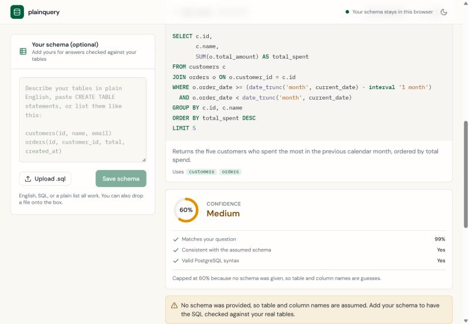
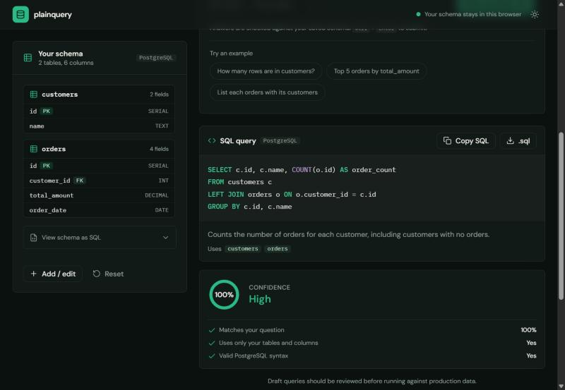
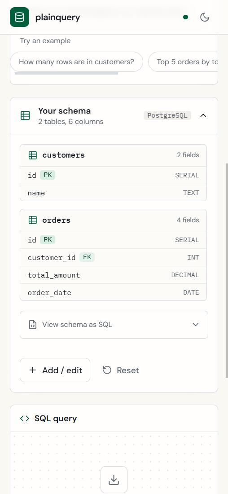
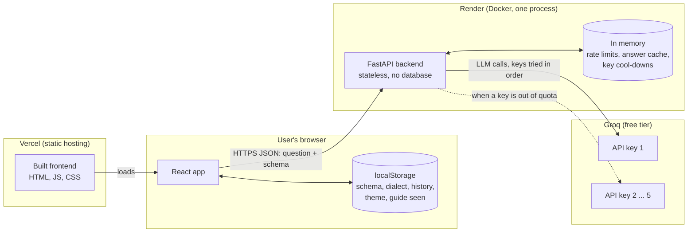
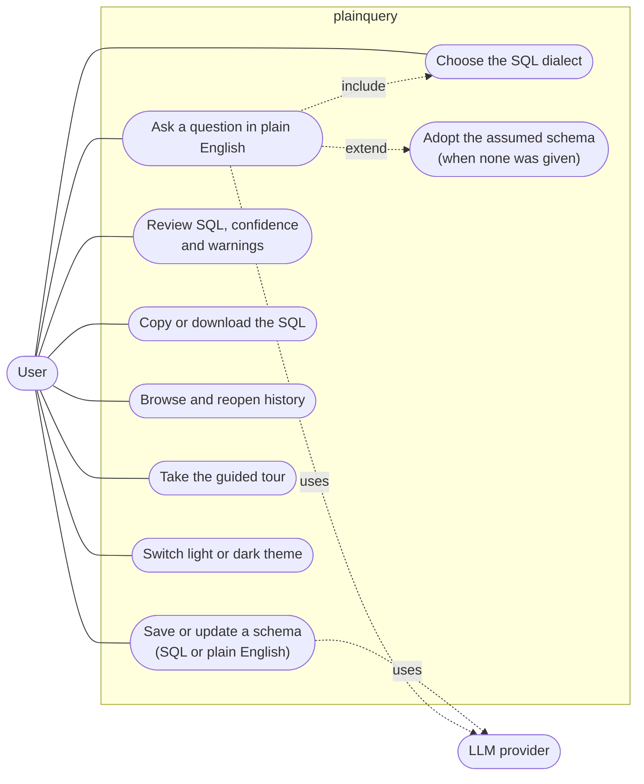
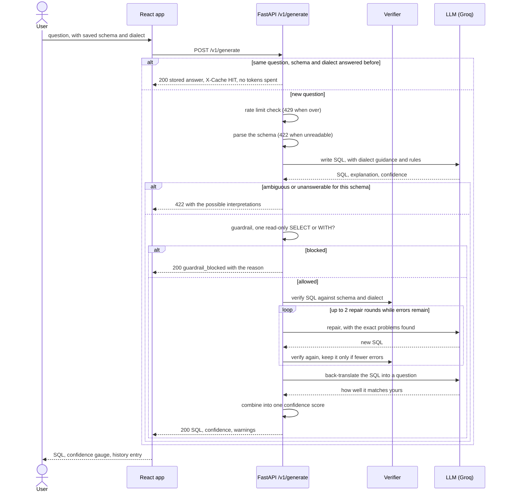
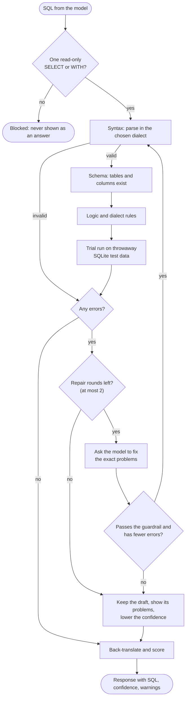
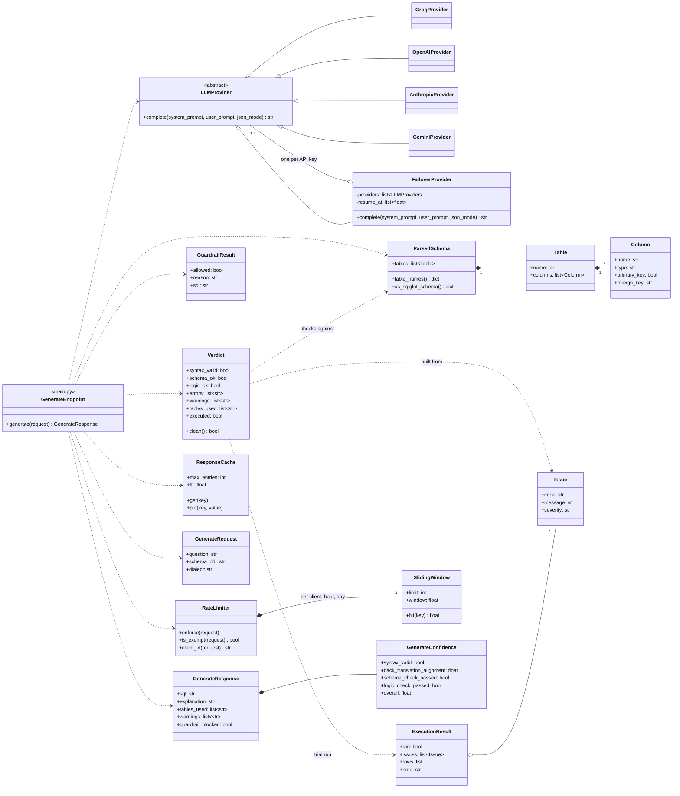
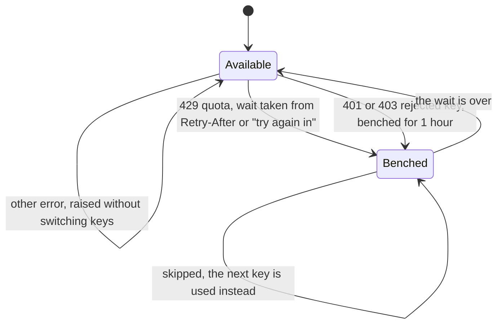
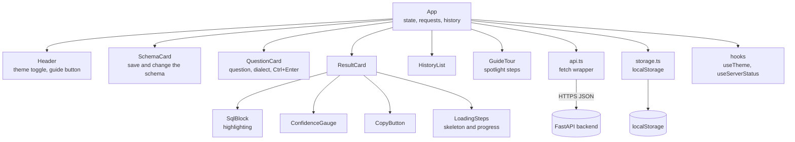

# plainquery: text to SQL, checked before you trust it

Describe your tables (plain English or `CREATE TABLE`), ask a question, get SQL
for your database dialect, plus a confidence score that says how far to trust it.

There is **no database behind it**. Your schema lives in your browser and travels
with each request; the backend never connects to anything and never runs a query.
The whole thing deploys free: a Groq key, a Render web service and a Vercel site.

<p align="center">
  
  
</p>

## What it does

- **Bring your own schema, optionally.** Paste DDL or describe tables in English
  ("customers(id, name), orders(id, customer_id, total)"). DDL is parsed
  deterministically; only English falls back to the LLM. Add to or change the saved
  schema later in plain English or SQL; a change is atomic and shows a diff, and
  nothing is removed unless you asked for a removal.
- **Or ask with no schema at all.** The model assumes one, tells you what it
  assumed, and you can adopt or correct it with a click. Confidence is capped at
  60% because the names are guesses.
- **Seven dialects:** PostgreSQL, MySQL, SQLite, SQL Server, Oracle, BigQuery, Snowflake.
- **Refuses to answer with anything destructive.** A request like "delete all
  cancelled orders" comes back as a blocked statement, not as SQL to paste.
- **Checks its own work and fixes it.** Every answer is verified (syntax, your schema,
  logic rules, a trial run on test data) and sent back to the model for repair when
  something is wrong, so errors like `= NULL`, unguarded division or a month rebuilt as
  `2025-00` are caught before you see them.
- **Says so when it can't answer.** Ambiguous questions return the possible
  readings; questions your schema can't answer say what's missing.
- **Confidence you can read.** Every answer carries a breakdown, not one opaque number.
- **A five-step guided tour** behind the Guide button in the header: a spotlight
  and a small card that glide from the schema to the question, dialect, generate
  button and result. Keyboard-friendly, and it docks to the bottom on phones.
- **History, dark mode, mobile layout, loading states, cold-start messaging**, all
  stored in `localStorage`.

<p align="center">
  
</p>

## How an answer is produced

```
 browser                              FastAPI (stateless)
┌──────────────┐  question + schema  ┌──────────────────────────────────────────────────┐
│ React + Vite │ ──────────────────> │ 1. parse the schema (sqlglot)                    │
│              │                     │ 2. LLM writes SQL, told this dialect's native    │
│ schema,      │                     │    date functions and the correctness rules      │
│ history and  │                     │ 3. guardrail: single read-only SELECT?           │
│ theme stay   │                     │ 4. verify: syntax -> schema -> logic -> trial run│
│ here         │                     │ 5. problems found? ask the LLM to repair (x2)    │
│              │ <────────────────── │ 6. back-translate the final SQL and judge it     │
└──────────────┘  SQL + confidence   └──────────────────────────────────────────────────┘
```

### Design decisions

**Your data is never touched.** The service has no connection to your database and
stores nothing. The guardrail exists so a tool never offers `DROP TABLE` as its
answer to a question that someone will copy into a console: anything that isn't one
`SELECT`/`WITH` statement is blocked (DML, DDL, stacked statements, writes hidden in
a CTE). The model is told to translate literally and not refuse, so the block is
deterministic and testable rather than depending on the model's mood.

**Parsing is not correctness.** SQL can parse, use only real columns, and still
compare to NULL with `=`, divide by a column that is sometimes zero, or rebuild a
month number into the month `00`. Every generated query goes through four stages:

| Stage | What it catches |
| --- | --- |
| Syntax and schema (`sqlglot`) | invalid syntax in the chosen dialect, invented tables and columns, `LIMIT` in SQL Server/Oracle |
| Logic rules (`sql_checks.py`) | `= NULL`, unguarded division, ungrouped columns, aggregates in `WHERE`, window functions in `WHERE`/`GROUP BY`, unordered `ROW_NUMBER`/`LAG`, SELECT aliases used where the dialect forbids them, joins with no condition, joins off the schema's foreign keys, impossible dates (`2025-02-30`), month numbers decoded with `% 12`, `YYYYMM` integers used for consecutive logic, streak queries that number duplicate rows, date arithmetic that doesn't mean days in that dialect |
| Dialect rules | functions and syntax that belong to another database (about 15 per dialect: `DATE_TRUNC` in MySQL, `YEAR()` in PostgreSQL, `EXTRACT` in SQL Server, `AS` before a table alias in Oracle, ...) |
| Trial run | the schema is turned into a throwaway in-memory SQLite database with deterministic data (year-end dates, repeats, NULLs, zeros, childless parents) and the query is run against it. Errors count, and so does a result containing a date that cannot exist |

The rules are structural checks over the parsed query, not patterns for particular
questions, so they apply to SQL nobody has written yet. A rule only fires when it is
confident; a missed issue is better than crying wolf.

**Repair, not just reporting.** When a stage finds errors, the model is sent the
question, its own SQL and the exact problems, and asked to fix them (up to two rounds,
each costing one LLM call). A repair is accepted only if it has fewer problems than the
draft and still passes the guardrail; otherwise the draft is kept and its problems are
shown, with lower confidence. The user is told when something was corrected.

**Prevention comes first.** The prompt tells the model how *this* dialect does the
things that go wrong most (month buckets, shifting dates by months, row limits) and
teaches the safe recipe for consecutive periods: reduce to one row per entity and
period, number those, group by the period shifted back by its row number. Those recipes
are generated from the same templates the tests use, and a test asserts they pass every
rule in every dialect, so the guidance and the validator cannot drift apart.

**Confidence** = `0.2 × model confidence + 0.5 × back-translation alignment + 0.3 × checks`
(checks score 1.0 if syntax, schema and logic all pass, 0.4 if not). The model's
self-assessment gets the smallest weight because it is the least reliable. With no
schema the result is capped at 0.6.

## Diagrams

The diagrams are [Mermaid](https://mermaid.js.org/), which GitHub renders in place.

### System architecture (deployment)



No database exists anywhere. The schema lives in the browser and travels with each
request, and the generated SQL is never run against real data.

### Use cases

Mermaid has no use-case diagram type, so this is drawn as a flowchart in the usual style.



### Sequence: answering a question



Answers with confidence under 0.5 and errors are not stored in the cache.

### Activity: verify and repair



### Class diagram: backend



### State: an API key

Each Groq key moves between these states. Keys are tried in the order given, so key 1 is
used again as soon as it is available.



When every key is benched, no request is sent and the user gets "The AI provider's free
quota is used up for now" with the time to come back.

### Components: frontend



## API

| Method | Path | Purpose |
| --- | --- | --- |
| `GET` | `/health` | liveness (used by Render) |
| `GET` | `/v1/dialects` | supported dialects |
| `POST` | `/v1/schema/analyze` | turn DDL or plain English into a structured schema |
| `POST` | `/v1/schema/update` | apply a plain-English or SQL change to a schema |
| `POST` | `/v1/generate` | question (+ optional schema) to SQL and confidence |

```bash
curl -X POST http://localhost:8000/v1/generate -H "Content-Type: application/json" -d '{
  "question": "Top 5 customers by total spend",
  "schema_ddl": "CREATE TABLE customers (id INT PRIMARY KEY, name TEXT); CREATE TABLE orders (id INT PRIMARY KEY, customer_id INT REFERENCES customers(id), total_amount DECIMAL);",
  "dialect": "postgres"
}'
```

The response has `sql`, `explanation`, `tables_used`, `warnings`, `guardrail_blocked`
and `confidence` (`syntax_valid`, `back_translation_alignment`, `schema_check_passed`,
`overall`). Ambiguous or unanswerable questions return HTTP 422 with
`detail.kind` set to `ambiguous` or `unanswerable`. Interactive docs are at `/docs`.

## Tech stack

- **Backend:** Python 3.11+, FastAPI, Pydantic v2, `sqlglot` (DDL parsing and schema-aware validation), `sqlparse` (guardrail)
- **LLM:** Groq `openai/gpt-oss-120b` by default behind a small provider interface; OpenAI, Anthropic and Gemini are drop-in via `LLM_PROVIDER`
- **Frontend:** React 18, TypeScript, Vite, Tailwind CSS, no UI kit
- **Tests:** pytest, Vitest + Testing Library, GitHub Actions

## Run it locally

You need a free [Groq API key](https://console.groq.com/keys).

```bash
cp .env.example .env          # then set GROQ_API_KEY
python -m venv .venv
.venv/Scripts/activate        # macOS/Linux: source .venv/bin/activate
pip install -r backend/requirements-dev.txt
cd backend && uvicorn app.main:app --reload
```

```bash
cd frontend && npm install && npm run dev
```

Open http://localhost:5173. On Windows, `.\scripts\local.ps1 backend|frontend|test|eval`
wraps the same commands (`-Port 8010` to change the API port). Or run both with
`docker compose up --build`.

## Tests

```bash
cd backend && pytest        # 700 tests, no network, no LLM key needed
cd frontend && npm test     # 225 tests
```

The backend suite runs the whole request pipeline against a scripted fake LLM, so
guardrails, schema parsing and updates, the logic and dialect rules, the repair loop and
the confidence math are all tested offline. Every rule is tested both ways: the broken
pattern is caught, and the correct way to write the same thing is left alone.

The consecutive-months scenarios (`tests/test_streaks.py`) run a reference query
against real rows and check the answers worked out by hand: Jan-Feb-Mar, a missing
month, Nov-Dec-Jan across a year end, ten orders in one month counting once, two
streaks (longest wins), equal streaks (earliest wins), a leap year. The broken
patterns run on the same data to show they really give wrong answers.

The eval's own comparison logic and golden dataset are tested too (every expected
query must run, return rows and pass the product's own checks).

## Eval

`eval/run_eval.py` sends 14 golden questions to a live API, the same way the UI
does, and grades them. The sample e-commerce schema (`eval/sample_db.py`) is loaded
into a throwaway in-memory SQLite database that exists only inside the eval: both
the generated SQL and the hand-written expected SQL run there and their rows are
compared (ignoring column names, column order and row order). Guardrail,
ambiguity and unanswerable cases check the API's refusal behaviour instead. Two of
the questions target the bug classes the verification pipeline exists for: a
consecutive-months streak (with hand-built customers for duplicates, a gap, a tie and a
year end) and a percentage that needs a guarded denominator.

```bash
python eval/run_eval.py --api-url http://localhost:8000
```

Results on 2026-11-10 with `openai/gpt-oss-120b`, two runs of the 14 questions:

| Run | Passed | Notes |
| --- | --- | --- |
| 1 | 11 / 14 | q6 answered instead of asking; q10's answer key had an arbitrary tie; q14 never said how statuses are spelled |
| 2 | 13 / 14 | after making q10 and q14 unambiguous; only q6 missed |

The two answer-key problems were mine, not the model's. The hand-built streak customers
created a tie for the busiest month, and the golden SQL had no tie-break; and the model
can't know the data stores `'cancelled'` in lowercase. Both questions now say what they mean.
The streak question (consecutive months with duplicates, a gap, a tie and a year end) passed in both runs.

The remaining miss, q6 ("What is the revenue?"), is the model being inconsistent about whether
to ask or answer: asked six times each, the earlier prompt asked 2 times and the current one 1.
That difference is within noise. A few questions is a smoke test, not a benchmark, so treat the
number as "works on a realistic schema", not as an accuracy rating. In CI the eval runs on pull
requests and manual dispatch (it spends the Groq key), not on every push.

The free Groq tier has a daily token cap (200k for this model). The verification prompt
is longer than before and a repair costs another call, so a request now uses a few
thousand tokens, and a full eval run uses a large share of a day's allowance.

## Deploy for free

1. **Backend on Render.** New, then Blueprint, pick this repo; it reads `render.yaml`.
   Set one secret, `GROQ_API_KEY`. To get more free daily quota, add extra keys as
   `GROQ_API_KEY2` ... `GROQ_API_KEY9`, or one comma-separated `GROQ_API_KEYS`; when a
   key runs out the app moves to the next and goes back to the first once it resets.
   Each key needs its own Groq account, so check Groq's terms before doing this. The free tier sleeps when idle, so the first
   request after a quiet spell takes about a minute; the UI says so while it waits.
2. **Frontend on Vercel.** Import the repo, set **Root Directory** to `frontend`,
   and add `VITE_API_URL` = your Render URL.
3. **Tighten CORS.** Set `CORS_ORIGINS` on Render to your Vercel URL
   (it defaults to `*`).
4. **Check the rate limits.** `RATE_LIMIT_PER_MINUTE` (per address),
   `RATE_LIMIT_PER_HOUR` and `RATE_LIMIT_PER_DAY` (everyone) protect your Groq quota; set a
   value to `0` to turn it off. The daily default is 20 questions per Groq key, from a
   rough estimate of about 9,000 tokens a question; answers served from the cache don't
   count. To exempt your own machine on the deployed site, set `RATE_LIMIT_EXEMPT_IPS` to
   your public IP (comma-separated for several). Direct connections from your own
   computer or network (local development, Docker) are exempt automatically, but
   requests arriving through a proxy such as Render never are. `TRUSTED_PROXY_HOPS` is how many proxies sit in front of the app (`1` on
   Render). If every visitor appears to share one address, the number is too high.
   Over the limit, the API returns HTTP 429 with a `Retry-After` header and the UI shows
   the message.

## Project layout

```
backend/app/
  main.py               endpoints and the generate pipeline
  schema_parser.py      DDL parsing, plain-English to DDL, atomic schema updates
  schema_validation.py  dialect parse + unknown table/column detection
  sql_checks.py         logic and dialect rules over the parsed query
  sql_execution.py      throwaway SQLite trial run on generated test data
  verification.py       syntax -> schema -> logic -> trial run, one verdict
  dialect_guide.py      per-dialect date recipes and the rules given to the model
  sql_generation.py     prompts for generation and repair
  guardrails.py         single read-only SELECT check
  validation.py         back-translation judge and confidence formula
  llm/                  provider interface + Groq, OpenAI, Anthropic, Gemini, key failover
  rate_limit.py         per-client and overall request limits
  cache.py              remembers finished answers
backend/tests/          pytest suite
frontend/src/           React app (components, hooks, api, localStorage)
eval/                   golden dataset, sample database, eval runner
render.yaml             Render Blueprint
```

## Limitations

- **Confidence is a signal, not proof.** A query can pass every check and still be wrong; read it.
- **The checks are best effort.** They are structural rules that only fire when confident,
  and the dialect rules are a curated list, not a full grammar. Subtle mistakes can pass,
  and nothing here can tell whether the SQL answers the *meaning* of your question beyond
  the back-translation check. Treat a high score as "no known problems", not "correct".
- **The trial run uses SQLite for every dialect.** Other dialects are translated first, so
  only errors that are the query's own fault count, and constructs SQLite lacks are
  skipped rather than blamed on the query. It runs on made-up data, never yours.
- **Repairs cost extra LLM calls** (up to two per request) and add a little latency when
  the first draft has problems.
- **The endpoints are unauthenticated** and spend your Groq key. They are rate limited
  (10 requests a minute per address, 120 an hour and 20 a day per API key overall, all
  configurable), which keeps visitors from using up the quota but is not access control.
  Requests from your own computer are exempt. The limits are kept in
  memory, so they reset on restart and are per instance.
- **Repeated questions are cached** (500 answers for 24 hours, in memory, so per
  instance and gone after a restart) to save tokens. The same question, schema and
  dialect returns the stored answer, so asking again won't give a different attempt.
  Weak answers (confidence under 50%) and errors are never stored. Set `CACHE_MAX_ENTRIES=0`
  to turn it off.
- **LLM output varies** between runs, as the eval shows.
- Fonts load from the Google Fonts CDN.

## License

[MIT](LICENSE)
